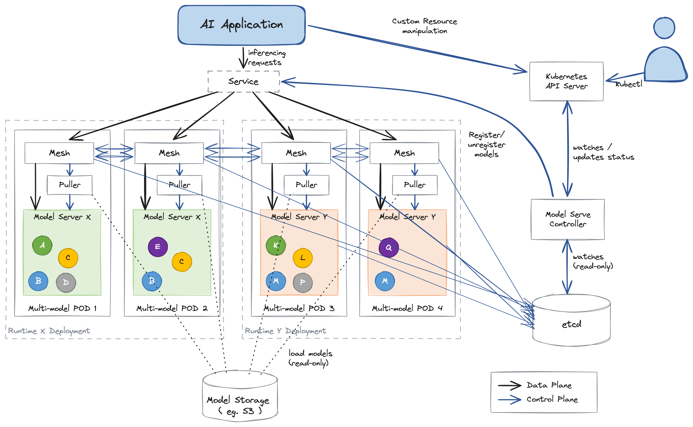

## From Single Models to High-Density ModelMesh

KServe transitions a bare kubernetes infrastructure into a production level AI inference platform, facilitating lifecycle/traffic management ( including scale to zero ), providing a unified control plane, model loading ( via a init sidecar ), and standardisation for the inference protocol. The resulting architecture of KServe though requires a few decisions upfront to be on the correct side of the trade-offs.  

The baseline KServe setup typically includes an InferenceService which equals one dedicated Kubernetes deployment. This configuration is best suited for large, monolithic models, heavy GPU-bound workloads or single-tenant isolated environments. Recently KServe started suggesing this Standard deployment mode ( 2026 ) as the prefered approach to setup LLM inference. This approach though breaks rather fast in deployments when 1000s of distinct lightweight models ( such as serving individualized fraud detection models for each corporate client ). Quick peek at the numbers makes this clear; 3000 models mean 3000 pods in raw deploy mode, with minimum 2 sidecars ( queue-proxy, istio envoy ) per pod, thats 9000 running containers before a single inference request is served. Costs could easily accumulate raiseing some red flags, and as importantly consider the environmental impact of the wasted energy. 

VPC IP address exhaustion form individual workloads is also a bit of a headached for the kubernetes scheduler especially during node rotations. Dealing with this many instances makes debugging a bit of a pain, even just trying to pick the one you are trying to poke among the haystack is burdensome. 

The engineering remedy in this case is to decouple the lifecycle from the compute;
To scale to thousands of distinct models without hitting infrastructure gridlock, it is necessary to break the immutable coupling between a Model Artifact and a Kubernetes Pod. Instead of a 1:1 mapping, the architecture requires shifting toward Multi-Model Serving (MMS) and dynamic lifecycle management.

Here is how modern cloud-native architectures solve the pod explosion problem within KServe and its ecosystem:

1.Shared Runtimes and Multi-Model Serving (MMS)
Instead of provisioning a dedicated pod per model, you deploy a pooled cluster of shared inference runtimes (such as Triton Inference Server or MLServer) managed by KServe.

The Mechanism: A single Kubernetes pod—accompanied by its mandatory sidecar pair—hosts a runtime engine capable of loading, executing, and unloading dozens or hundreds of discrete model artifacts concurrently.

The Impact: If you host 50 lightweight fraud detection models inside a single pod, your 3,000-model footprint drops from 3,000 pods (9,000 containers) down to 60 pods (180 containers). IP exhaustion is instantly mitigated, and Kubernetes schedulers breathe easier.

2.Dynamic Model Loading and LRU Caching
When dealing with thousands of tenant-specific models, keeping every model loaded in memory simultaneously is economically and computationally unviable—especially since 90% of those models may sit idle for hours.

On-Demand Loading: Runtimes like Triton support dynamic model control APIs. When an inference request arrives for a cold model, the runtime fetches the weights from the object store on the fly, registers the model into memory, and serves the request.

LRU Eviction: Combined with a Least Recently Used (LRU) cache policy, inactive models are gracefully unloaded from memory, freeing up RAM or GPU VRAM for active workloads.

3.ModelMesh Integration
For large-scale, high-density tabular or lightweight model deployments, KServe integrates with ModelMesh as an alternative to Knative's per-service routing.

Intelligent Routing: ModelMesh introduces a distributed routing layer across a pool of identical model-serving pods. It transparently tracks which pod currently has a specific model loaded in memory.

Request Forwarding: If a request lands on a pod that doesn't have the target model loaded, ModelMesh internally routes or proxies the request to the correct pod (or triggers an on-demand load), abstracting away the multi-tenant routing complexity from the client.

The Engineering Trade-offs
While multi-tenant model sharing solves pod proliferation and infrastructure costs, it introduces a new set of operational challenges that require careful mitigation:

Cold-Start Latency: An on-demand model load can introduce noticeable latency spikes (seconds, depending on weight size and object store throughput) for the first client request. Pre-warming hot models or maintaining a persistent cache layer is essential for real-time SLAs.

Noisy Neighbors & Resource Contention: Because multiple models share the same container memory and CPU/GPU compute pool, a rogue model with a memory leak or a sudden traffic spike can starve neighboring models. Strict cgroup limits, memory budgets, and runtime isolation boundaries are mandatory.

Blast Radius: A crash in a shared runtime process affects all tenant models hosted within that specific pod, raising the stakes for runtime stability and fault isolation.

