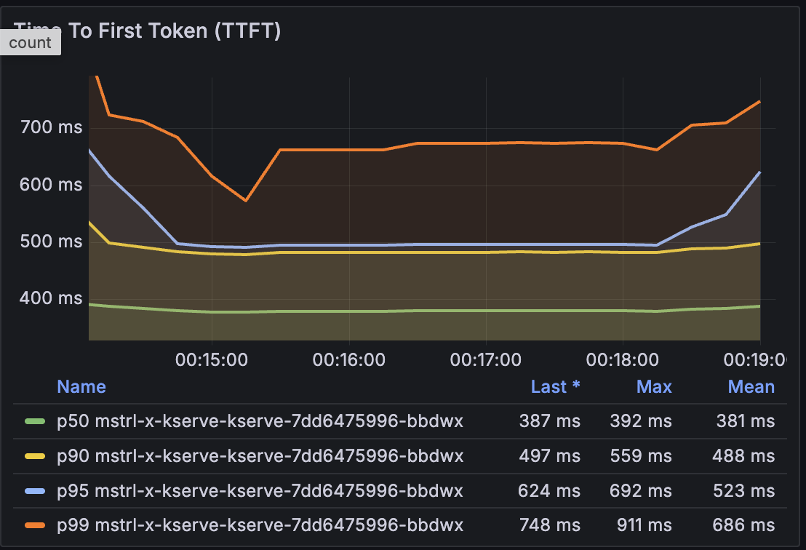

---
title: "Rethinking Serving Metrics for AI Inference"
description: "Metrics to optimize for in Software & AI delivery"
pubDate: 2026-10-31
tags: ["metrics", "optimization", ""]
---
Metrics that work well for web services can mislead when applied to AI inference. Inference workloads have different performance and resource constraints, so a system can look healthy on traditonal dashboards while users still experience slow or inconsistent responses.  _everything looks green but users are suffering_.

Below covers why;
- Serving pipelines for traditonal web-service requests are roughtly similar in costs however in AI inference _output is non-deterministic_ - especially when serving LLMs , one request can be 10 tokens, while the next might generate 10000 tokens; thats 10000 to 1 imbalance
- _Hardware is expensive._ An 8–16 vCPU CPU node may cost £30–£100 per month, while a GPU node (for example, one equipped with an NVIDIA H100 or A100) can cost £1,500–£10,000 or more which is roughly 50–100 times as much. Inference costs also depend on the unit being measured: traditional web serving may cost $0.01–$0.05 per million requests, while LLM inference may cost $0.50–$3.00 or more per million tokens. These figures are not directly comparable—requests and tokens are different units—but they highlight why AI serving requires careful utilisation of the resources ( Cost quoted are as of Q4 2026 )
- AI models spit out a probabilistic output, "works" is a quality spectrum, and a simple 200 status code as in software may not be sufficient to call it a success. In a typical web-service serving pipeline correctness is binary
- Statefulness: during generation, the KV cache stores prior tokens’ keys and values so they do not need to be recomputed at every step. This cache consumes GPU memory and grows with active sequences, making memory a scarce resource and potentially requiring requests to remain associated with their cached state.
- Provision timelines are off by an order of magnitude; 50ms startup for a CPU workload ( Warm pool, image load, process init ) can easily go above 60 seconds for provisioning a GPU which includes runtime setup (CUD/CuDNN/drivers), context init, model load ( host RAM->VRAM transfer, longer if downloading from storage), and graph capture. That's 120 times longer


## AI Metrics to Optimize For
Now we know traditonal web-serving metrics won't be sufficient and potentially misleading for AI inference, what are the metrics we should be optimizing the system for?


### Time to First Token (TTFT)
This is the latency between the user request to the generative AI inference service, and getting back the first generated token from the model
```text
Request arrives                                             Response ends
	│                                                           | 
	▼               .- Tokenization           Detokenization -. | 
                    |                                         | ▼ 
	├─ Queueing ──┼───┼──── Prompt prefill ────┼── Decode ──┼───┤
	│             │   │                        │  token 0   │   │
	└─────────────┴───┴────────────────────────┴────────────┴───┘
	◄──────────── TTFT ─────────────────────────────────────────►
```
TTFT is dominated by prefill latency which is a compute bound workload that scales with prompt length, batching/scheduling policy, and compute/memory-bandwidth bottlenecks on the accelerator. Conversely Tokenisation/Detokenisation take a tiny fraction of the TTFT ( Deterministic Rust/C code ) with latency under 1ms. 

Depending on the use case the P95 TTFT target could range from sub 200ms to many seconds. An interactive system such as real-time voice or interactive messaging feels snappy with TTFT above a second, whereas tool orchestration/long runing batch jobs TTFT is less of a concern when the throughput matters more. Pick your battles depending on the use case  


Above is a TTFT snapshot with under a 400ms p50 and under a second p99 latency which is within the acceptable range for interactive workloads.

### Time Per Output Token / Inter Token Latency ( TPOT / ITL )
This is the latency between each subsequent token generated until the model's response ends. 
```text
- @todo: draw TPOT diagram
Request arrives                                             Response ends
	│                                                           | 
	▼               .- Tokenization           Detokenization -. | 
                    |                                         | ▼ 
	├─ Queueing ──┼───┼──── Prompt prefill ────┼── Decode ──┼───┤
	│             │   │                        │  token 0   │   │
	└─────────────┴───┴────────────────────────┴────────────┴───┘
	◄──────────── TTFT ─────────────────────────────────────────►
```
As opposed to TTFT ( which is compute bound ), TPOT is memory bound.  During decoding, the model generates one token at a time. Each step reads model weights and active KV-cache entries from accelerator memory. As a result, memory bandwidth and cache capacity often limit generation speed before compute capacity is fully used.

### End-to-end latency
The time from a request arriving until the complete response is available. For a streamed response, this includes queueing, tokenization, prompt prefill, decoding every output token, and any finalization or network delay after the last token. For a response with $N$ output tokens, a useful approximation is:

	$$
	T_{\text{end-to-end}} \approx \text{TTFT} + (N - 1) \times \text{average TPOT} + \text{finalization overhead}
	$$

This makes output length part of the latency story: two requests with identical TTFT and TPOT can have very different completion times if one generates many more tokens. This output variability is not a typical concern in traditional web-serving workloads, but does make a significant difference in generate AI workloads

### Token Throughput
This metric provides the overall serving capacity when measured across the system ( Multi node/ GPU setup ) and potential bottleneck GPUs when measured per GPU. Below is a snapshot of token throughput on a GPU responding to a request after an idle period.
 

Token throughput should be considered alongside requests per second; a high request rate can consist of many short exchanges, while a lower request rate can still drive substantial token throughput with long prompts or generations. 

- Token Goodput is the throughput that meets the latency SLOs ( i.e Qualifying tokens/sec ). The ratio between token goodput and throughput is a good indicator of whether to start investigating bottlenecks in TPOT
 
## Hardware Utilization
- Mechanical sympathy is a hard requirement when working with GPUs and oversimplified metrics such as GPU utilisation is a shallow indicator into system efficiency. Additonally, hardware utilisation analysis requires distinguishing hardware telemetry ( GPU Metrics ) from engine/serving telemetry ( vLLM, SGLang etc.. ) and interpreting them across the two distinct phases of generation; prefill (compute-heavy) and decode (memory-bandwidth-heavy autoregressive process).

### Model FLOPs utilisation ( MFU )
- Measures how effectively the raw GPU compute capability ( Theoretical peak floating-point compute capacity ) ise used for actual model compute. First introduced in 2022 paper https://arxiv.org/abs/2204.02311 ( a good read )
$$\text{MFU} = \frac{\text{Achieved Useful Model FLOPs/s}}{\text{Peak Hardware FLOPs/s}}$$
Larger bathes/optimized batching strategy ( continuous batching ), longer prompts ( high prefill to decode ratio ), avoiding stall ( eg. high prefix cache hit rate ), fused kernels, cuda graphs help improve MFU conversely memory stalls, idle time, small batch sizes, upstream bottlenecks ( slow tokenisation, network I/O, KV Offload stalls ) hurt MFU. 

## KV-Cache
- Prefix cache is formed during the prefill phase. During prefill, the model processes input tokens in parallel and stores their computed key-value (KV) attention states. Inference engines like vLLM retain these KV blocks so later requests with an identical starting sequence can reuse them

### KV-Cache Utilisation
Percentage of KV-cache blocks/pages currently occupied by active sequences. A healthy KV-cache utilization rate in LLM inference is below 80%. Sufficient memory headroom is important to avoid active requests triggerring preemptions, evictions, or out-of-memory errors.
### KV-Cache Hit Rate
Percentage of input tokens served from previously computed attention states fetched from memory rather than recomputed. Higher hit rates reduce time-to-first-token (TTFT). A typical setup achieves 50-60% Hit rate, while highly optimized setups with repetitive agentic workload could reach 80%. 
### KV-Cache Preemptions / Swaps
Measures scheduler has to evict a running sequence (or swap/offload blocks to host RAM/SSD) because KV blocks ran out mid-generation ( vllm:num_requests_swapped / preemptions ) 

### Request Queue Pending Time
- This metric indicates how long the users request waits in request queue before it is served. Combined with TTFT this metric typically triggers autoscaling ( KEDA/KNative setup )
### Pod Readiness Latency
- AI workloads are prone to suffer from cold-start problems. Pod readiness combines image pull, sidecar/init, model pull, and process start

## Cost Metrics
Inference Unit Economics to tie cost to output & traffic, often expressed per token

### Cost per 1M Input / Output Tokens
- Track input (prefill) and output (decode) separately because output generation is typically much more expensive per token on memory-bandwidth-bound GPUs.

### Cost per Request / Session / Agentic Task
- Essential when a single user workflow triggers multiple LLM calls, tool executions, or retrieval steps.

### Effective Cost per Useful Token
- Adjusts token spend for retries, timeouts, failed/aborted streams, or rejected speculative tokens so wasted compute isn't hidden.

### GPU / Node Cost per Hour ($/GPU-hr or $/node-hr)
- Blended cost across on-demand, reserved/savings plans, or spot instances.

### Idle & Wasted GPU Cost ($/hr)
- Spend on allocated GPUs that are sitting idle, under-utilized during off-peak hours, or over-provisioned for headroom/scale-down lag.

## Energy Consumption Metrics
### Tokens per Watt-Hour (tok/kWh)
- Direct energy-efficiency metric for comparing model sizes, quantization (FP8/INT8 vs. BF16), batching strategies, or engines (vLLM, SGLang, TensorRT-LLM).
- DCGM_FI_DEV_TOTAL_ENERGY_CONSUMPTION

### Energy per Model FLOP (J / GFLOP or J / TFLOP)
- Normalizes energy against useful model compute delivered.

### Idle / Standby Energy (kWh)
 Energy consumed while GPUs and nodes are provisioned/warm but serving little or no traffic

## Reliability Metrics

### Core Availability & Error Metrics (SLIs / SLOs)
Request Success Rate / Error Rate (4xx / 5xx): Percentage of inference requests that complete cleanly without transport/server errors, timeouts, or rate-limit rejections (429).

### Goodput / SLA-Compliant Request Rate
The rate of requests that succeed and meet latency SLOs (TTFT and ITL/TPOT)—a request that finishes in 45 seconds when your SLO is 2 seconds may still return 200 OK while failing the user experience.

### Stream Completion / Mid-Stream Abort Rate
 For token-streaming (SSE / gRPC) endpoints, tracks how often streams drop prematurely, time out mid-generation, or get canceled by clients/proxies before finishing.

### Availability / Uptime (%)
Proportion of time the serving endpoint/revision can accept and process valid traffic without outage or unready fleet states.

### Latency Tail Stability & Jitter Metrics
P95 / P99 / P99.9 TTFT and ITL (TPOT): Tail latencies reveal contention, KV-cache pressure, batching spikes, and cold starts that averages hide.

### Latency Jitter / Token-to-Token Variance
Large swings in ITL cause choppy or "stuttery" token streaming even when median ITL looks fine.

### Queue Wait Time (queue_duration_seconds)
Tracks whether requests are backing up in gateway/engine queues or getting shed/timed out under load spikes.

### Engine / Worker Crash & Restart Rate (CrashLoopBackOff / restarts)
Detects runtime panics, CUDA errors, hanging workers, or stuck scheduler loops.

### Replica Readiness & Autoscaler Responsiveness
Time to scale up from zero or absorb bursts (Desired vs. Ready replicas), plus pod eviction/preemption counts (e.g., spot/node pressure).

### GPU Hardware & Driver Faults (DCGM_FI_DEV_XID_ERRORS, ECC errors, thermal/power throttling)
Xid errors, double-bit ECC errors (DBE), or NVLink/PCIe errors can silently or overtly degrade a single GPU inside a multi-GPU replica—requiring drain/cordon or node replacement.


